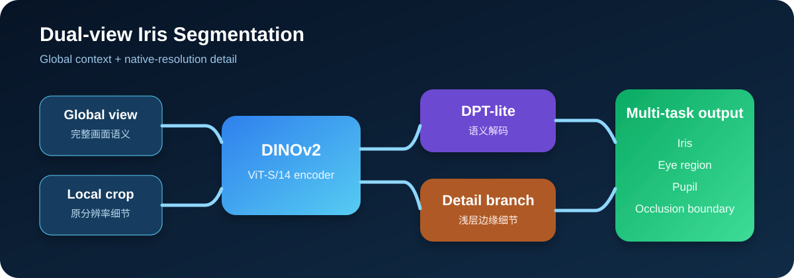
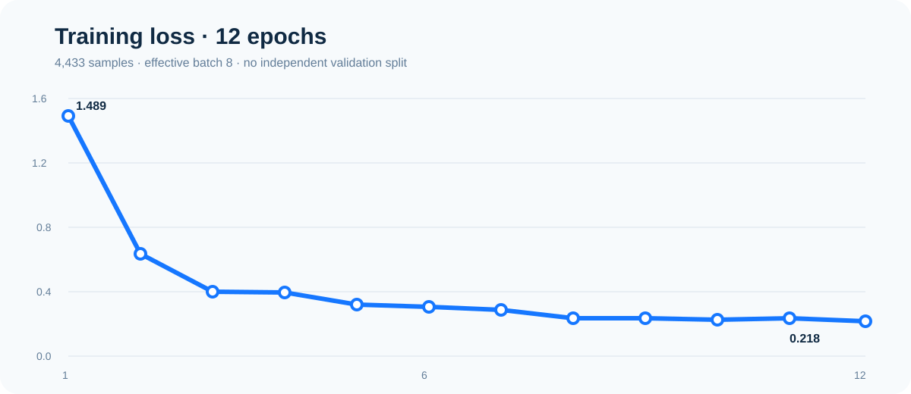
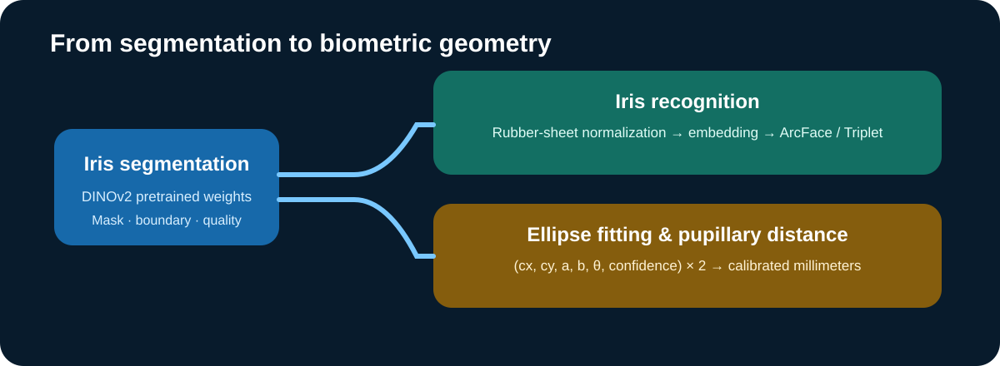

# Iris Segmentation Model

一个面向可见光人眼图像的虹膜分割实验项目，包含数据协议、DINOv2 双视图模型、训练与评估命令、自动标注工具和 Windows GUI。



## 当前版本

- 训练数据：4,433 张，来自 12 个数据源；原始数据不随仓库发布。
- 训练方式：全图与原分辨率局部裁剪混合训练。
- 主干：DINOv2 ViT-S/14。
- 解码器：DPT-lite 语义分支 + 浅层卷积细节分支。
- 任务：虹膜、可见眼球、瞳孔和遮挡边界多任务监督。
- 训练轮数：12 Epoch；最终训练 loss 为 0.21809。
- 推理权重：`models/iris_segmentation_ema_fp16.pth`，仅包含 EMA 推理参数，不包含优化器、训练样本路径或数据哈希。
- 测试：29 项单元测试通过。

> 当前实验没有独立的受试者隔离开发集，因此训练 loss 不能当作泛化指标。模型适合研究、复现和后续微调，不应直接用于医疗或身份认证场景。

## 推理模式

| 模式 | 计算方式 | 适用场景 |
|---|---|---|
| `fast` | 整图缩放后单次推理 | 已裁剪的单眼图、低延迟预览 |
| `standard` | 全局图 + 单尺度切片 | 速度与细节折中 |
| `high` | 多尺度切片 + 翻转融合 | 高分辨率全脸图、离线验收 |

全脸照片中的虹膜很小时，`fast` 可能漏标；`high` 能保留更多细节，但也可能放大头发、眼镜或衣物上的困难负样本。更稳妥的部署方向是先定位眼睛 ROI，再对眼部裁剪执行单次分割。

## Windows 快速开始

需要 Python 3.11。NVIDIA CUDA 12.8 环境可运行：

```powershell
Set-ExecutionPolicy -Scope Process Bypass
.\setup_env.ps1
.\start_gui.bat
```

CPU 或其他 CUDA 版本请先根据 [PyTorch 官方安装说明](https://pytorch.org/get-started/locally/) 安装匹配版本，再执行：

```powershell
python -m venv .venv
& '.\.venv\Scripts\python.exe' -m pip install -e .
```

## 自动标注

```powershell
& '.\.venv\Scripts\python.exe' -m iris_system.cli.annotate `
  --images 'D:\path\to\images' `
  --model '.\models\iris_segmentation_ema_fp16.pth' `
  --preset high `
  --target iris
```

输出包含原图、二值 Mask、叠加对比图与不确定度排序。

## 数据目录

CVAT 数据：

```text
dataset/
├── annotations.xml
└── JPEGImages/ 或 Images/
```

外部 Mask 数据：

```text
dataset/
├── Images/
├── Masks/       # 可选
└── Fill/        # 可选
```

多个独立数据集应分别作为 `--root` 传入，避免把备份目录或 Benchmark 混入训练。

## 训练

先生成锁定清单：

```powershell
& '.\.venv\Scripts\python.exe' -m iris_system.cli.data `
  --root 'D:\dataset_a' `
  --root 'D:\dataset_b' `
  --output '.\manifests\train.jsonl'
```

完整重构：

```powershell
& '.\.venv\Scripts\python.exe' -m iris_system.cli.train `
  --mode rebuild `
  --manifest '.\manifests\train.jsonl' `
  --run-name 'rebuild_01' `
  --max-epochs 12 `
  --batch-size 2 `
  --gradient-accumulation 4 `
  --num-workers 4 `
  --amp
```

正式实验应另外准备按受试者或拍摄序列隔离的开发集，使用 `--val-manifest` 选择最佳 epoch；Benchmark 只在方案冻结后使用。

## 训练曲线



第 1–12 轮训练 loss：1.4890、0.6355、0.4021、0.3975、0.3237、0.3080、0.2907、0.2418、0.2417、0.2351、0.2418、0.2181。

## 轻量化部署方向

1. 眼睛检测或人脸关键点先裁剪 ROI；
2. 在 ROI 上使用 `fast` 单次分割；
3. 导出 ONNX FP16，并在 Windows GPU 上使用 TensorRT；
4. 以知识蒸馏训练 MobileNetV3/EdgeNeXt 等轻量学生模型；
5. 使用困难负样本减少头发、眼镜、反光和衣物虚标。

## 后续研究



### 虹膜识别

分割后执行极坐标归一化（rubber-sheet），训练身份嵌入网络，并用 ArcFace/Triplet Loss 优化类间距离。正式身份识别还需要质量筛选、活体检测、阈值标定与隐私保护。

### 虹膜椭圆与瞳距检测

复用当前模型权重初始化编码器，增加椭圆参数回归头，预测左右虹膜或瞳孔的 `(cx, cy, a, b, θ, confidence)`。像素瞳距是两侧中心点距离；毫米瞳距还需要相机标定、深度/尺度参考或已知尺寸参照物，不能只依赖单张无标尺自拍直接换算。

## 项目结构

```text
configs/       模型、训练和数据协议配置
models/        推理检查点
src/           数据、模型、训练、评估、推理和 GUI
tests/         数据协议、几何与模型测试
docs/images/   文章与仓库图片
```

技术文章：<https://sheeplhy.github.io/posts/iris-recognition-pipeline/>

